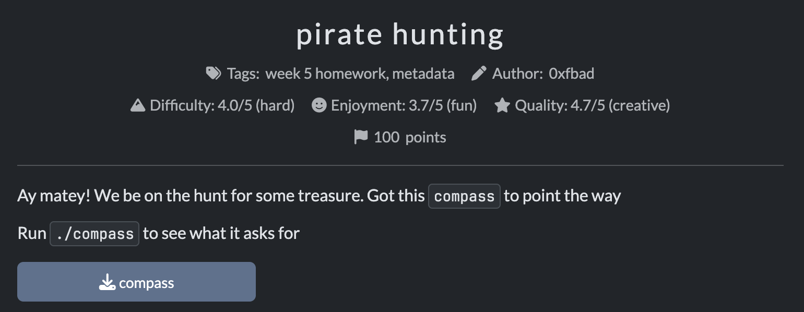
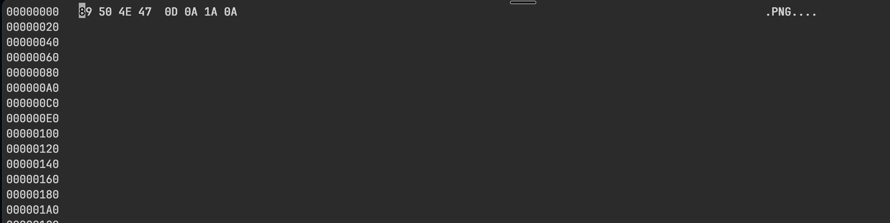

# Pirate Hunting
Task: Pirate Hunting

Description: Ay matey! We be on the hunt for some treasure. Got this compass to point the way. Run ./compass to see what it asks for

Category: Week 5, metadata

Provided Files: `compass`



### Initial thoughts
Since it is an executable, I would type `chmod +x <file>` to give it permission to run. I am skeptical of it running properly though do to the category being related to metadata.

---

### Running the executable
In the directory the compass file is located in I ran this comand.

```
$ chmod +x compass
$ ./compass

Usage: ./compass <file>
```

After running the executable, it tells us that this command can be used on other files. At the moment I didnt have any other files in my directory, other than `compass` itself, so I just ran the executable on the file itself.

```
$ ./compass compass

ImageDescription field is missing.
Artist field is missing.
Copyright field is missing.
Make field is missing.
Model field is missing.
Software field is missing.
DocumentName field is missing.
```

So it seems like I've hit a wall because the challenge only gives me one file (the executable) to work with. I'm wondering if there would be any hidden files inside the file which I could run the command on. My objective now is to decipher any hidden files.

### Finding hidden files

One of the commands we learned from class on finding files appended to another file is `binwalk`. This command scans a binary file for any other files.
```
$ binwalk compass

DECIMAL       HEXADECIMAL     DESCRIPTION
--------------------------------------------------------------------------------
0             0x0             ELF, 64-bit LSB executable, AMD x86-64, version 1 (GNU/Linux)
510016        0x7C840         Unix path: /usr/share/locale
522702        0x7F9CE         Unix path: /usr/lib/getconf
528576        0x810C0         Unix path: /usr/lib/x86_64-linux-gnu/gconv
530608        0x818B0         Unix path: /usr/lib/locale
532608        0x82080         Unix path: /usr/lib/locale/locale-archive
570632        0x8B508         ESP Image (ESP32): segment count: 3, flash mode: QUIO, flash speed: 40MHz, flash size: 1MB, entry address: 0x0, hash: none
572096        0x8BAC0         ESP Image (ESP32): segment count: 4, flash mode: QUIO, flash speed: 40MHz, flash size: 1MB, entry address: 0x0, hash: none
597367        0x91D77         Unix path: /usr/lib/x86_64-linux-gnu/
```
The two ESP image files are interesting to us. In order to extract them, `tldr binwalk` tells us to use the command `binwalk --dd '<file signature>' path/to/binary` to extract a file with a specified file signature in mind.
```
$binwalk --dd 'ESP Image: esp' compass
$tree
.
├── compass
└── _compass.extracted
    ├── 8B508. esp
    └── 8BAC0. esp
```
Now we have a new folder in our directory called `_compass.extracted`. Insided are our `.esp` files.

### Doing stuff with the extra files

Initially I ran the compass on the esp files and for both I got the "xyz field is missing..."

```
$ ../compass 8B508.\ esp 

ImageDescription field is missing.
Artist field is missing.
Copyright field is missing.
Make field is missing.
Model field is missing.
Software field is missing.
DocumentName field is missing.

$ ../compass 8BAC0.\ esp 

ImageDescription field is missing.
Artist field is missing.
Copyright field is missing.
Make field is missing.
Model field is missing.
Software field is missing.
DocumentName field is missing.
```

Having exhausted files, I decided to run compass on the `compass.extracted` folder and I actually got a different output. The pirate speak is pretty funny. 

```
$ ./compass _compass.extracted 

Yer ImageDescription should be marked 'X marks the spot'...
Yer Artist should be signed by 'Cpt. Long John Silver'...
Yer Copyright should bear the warning 'Hands Off The Loot'...
Yer Make should be captured by 'Hispaniola'...
Yer Model should be sighted through a 'Brass Sextant'...
Yer Software should be charted with 'DeadReckoner v0.8.2'...
Yer DocumentName should be a 'Captain's Chart'...
```

I wonder if we have to change some files fields metadata fields to this and then point the compass, and it will reveal the "treasure"? 

### Updating metadata
First I tried updating the metadata on the compass. It didn't work because file type doesn't support it.
```
$ exiftool -ImageDescription="X marks the spot" compass 

Error: Writing of this type of file is not supported - compass
    0 image files updated
    1 files weren't updated due to errors
```
I then tried to create a new png file, change the file signature (`89 50 4E 47 0D 0A 1A 0A`) to prove it is a png, but because it was not a complete and properly formatted png file, updating exiftool also didn't work.
```
$ touch image.png
$ hexedit image.png 
```

> Editing the file signature
```
$ exiftool img.png 
File Type                       : PNG
File Type Extension             : png
MIME Type                       : image/png
Warning                         : Truncated PNG image
```
> Partial output to exiftool showing that it's a png, but it's not like a real png

```
$ exiftool -ImageDescription="X marks the spot" img.png 
Warning: Truncated PNG image - img.png
Error: Error writing output file - img.png
    0 image files updated
    1 files weren't updated due to errors
```
So I think the issue is that I need to find a proper png, then edit its metadata with the info I found above, and then point the compass. I could probably do this by downloading a random png off the internet. I know I have a png in a [github repo](https://github.com/snowykritter/custom-cursor/blob/master/GreenCheekedConure/LinkSelect.png) I own.

```
$ exiftool -ImageDescription="X marks the spot" LinkSelect.png
    1 image files updated
```
FINALLY! Updating the metadata of this file works!!! Hopefully updating rest of metadata goes flawlessly. I'm so tireddddddd. I can string together the metadata tags into one command to update all at once.
```
$ exiftool -Artist='Cpt. Long John Silver' -Copyright='Hands Off The Loot' -Make='Hispaniola' -Model='Brass Sextant' -Software='DeadReckoner v0.8.2' -DocumentName="Captain's Chart" LinkSelect.png
    1 image files updated
```
For last tag, DocumentName, I had to use double quotes because I needed to distinguish for the apostrophe in the name. This command was a success. 

### Finding the treasure!
Now that my file with the correct metadata was set, I could run the `compass` executable and find the treasure.
```
$ ./compass LinkSelect.png
Aye.
Aye.
Aye.
Aye.
Aye.
Aye.
Aye.
Arrr! Here be the flag: cmpm{f4k3_1t_t1ll_y0u_m4k3_1t}
```

---
### Reflection
I had the right starting point with the compass and what I needed to use the compass for, until I had to update the actual metadata. I genuinely thought I was so smart to think of creating a png file using `touch` and then editing its file signature, but I learned that that's only one part of the picture for a file extension/type. Eventually I did figure out how to update the metadata on an image by downloading a proper png image from else where. After that it went smoothly. 
