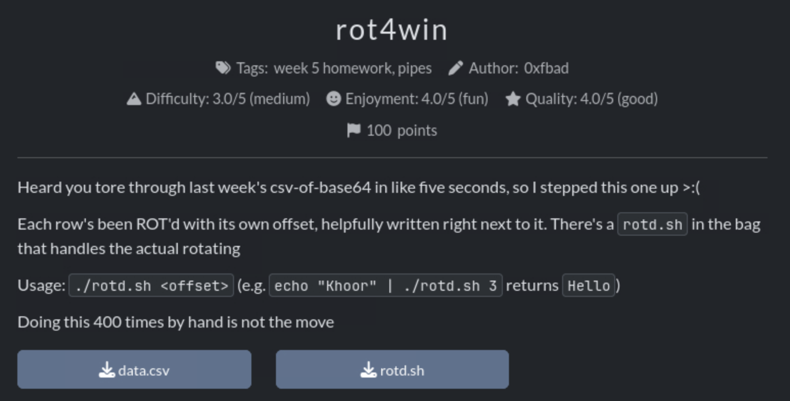

# Rot4win
Task: rot4win

Description: Heard you tore through last week's csv-of-base64 in like five seconds, so I stepped this one up >:(

Each row's been ROT'd with its own offset, helpfully written right next to it. There's a rotd.sh in the bag that handles the actual rotating

Usage: `./rotd.sh <offset>` (e.g. `echo "Khoor" | ./rotd.sh 3` returns Hello)

Doing this 400 times by hand is not the move

Category: Week 5, pipes

Provided Files: `data.csv`, `rotd.sh`



### Initial thoughts
 We have a csv file. This file will have a long list of data entries so we have to have a command that will recursively go through each entry. My first instinct is to use awk. We can use awk to take thd data entry row, echo it, and then pipe it into the ./rotd command with the offset like in the example. 

---

First lets give our `rotd.sh` script permissions to execute.
```
$ chmod +x rotd.sh
```

```
$ awk -F , '{print "echo " $2 "| ./rotd.sh " $1}' data.csv
```

WHY WONT THIS WORK
AHHHHH
LSAKJFLKDAJF

---
### Reflection
I give up 
