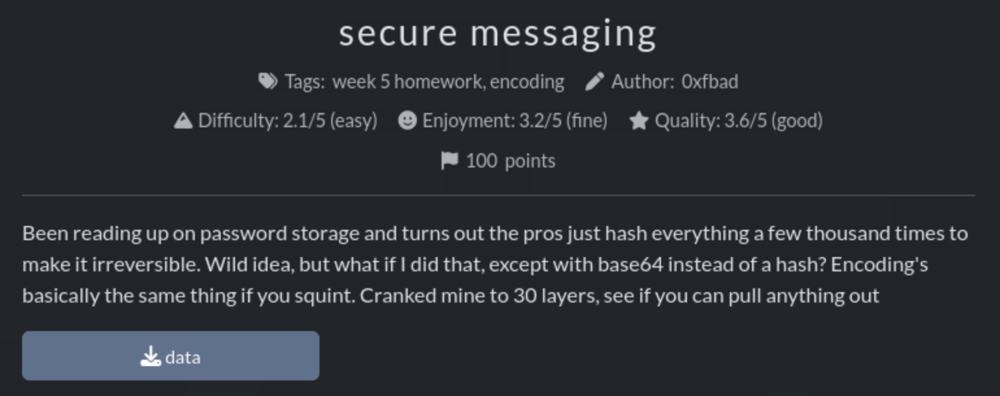

# Secure Messaging

Task: secure messaging

Description: Been reading up on password storage and turns out the pros just hash everything a few thousand times to make it irreversible. Wild idea, but what if I did that, except with base64 instead of a hash? Encoding's basically the same thing if you squint. Cranked mine to 30 layers, see if you can pull anything out

Category: Week 5, encoding

Provided Files: `data`



Initial thoughts: Encoding is different from a hash, and is reversible. I should be able to repeated use base64 to decode it 30 times and get the output!

---

This is the program I want to follow. However I didn't really know what the syntax is in the terminal. I decided to search them up. I do know that for loops are possible.

1. Initialize variable and update it with first output to base64 decoding
	https://www.howtogeek.com/442332/how-to-work-with-variables-in-bash/

2. Run a loop from 1 to n (where n=30 in this case)
	https://www.geeksforgeeks.org/linux-unix/for-command-in-linux-with-examples/

3. Inside the loop, we are updating the variable with the current variable concatenated with the command.
	- we can reference the variable using `$<variable_name>`
	- `printf` basically puts the variable in plain text for the command

This is the full command I ran:
```
$ result=$(cat data)
for i in {1..30}; do
    result=$(printf "$result" | base64 -d)  
done 
printf "$result" | cat
```
> `result=$(cat data)` sets the variable result. 
`$(...)` runs a command inside a commnd. `printf ".."  |  cat` outputs the command

Output:
```
First determine skill hotel back. cmpm{n07_qu173_pbkdf2_a5qncz}  
```
---
### Reflection
I generally knew what I had to do, but I've never used for loops in the command line before, so I had to research how to use them. I feel like this challenge was pretty straightforward compared to pirate hunting. My write up also feels short because of it :(